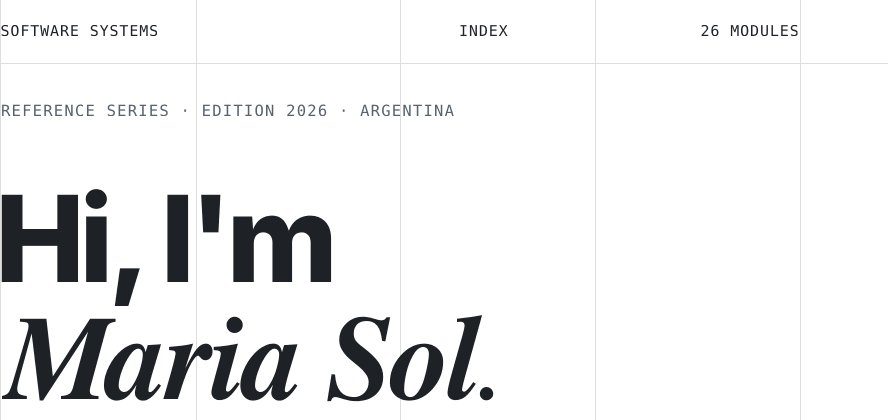
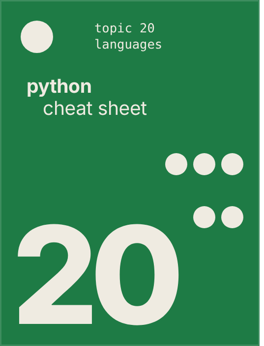
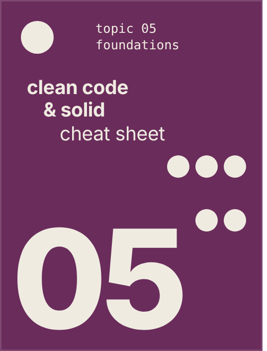
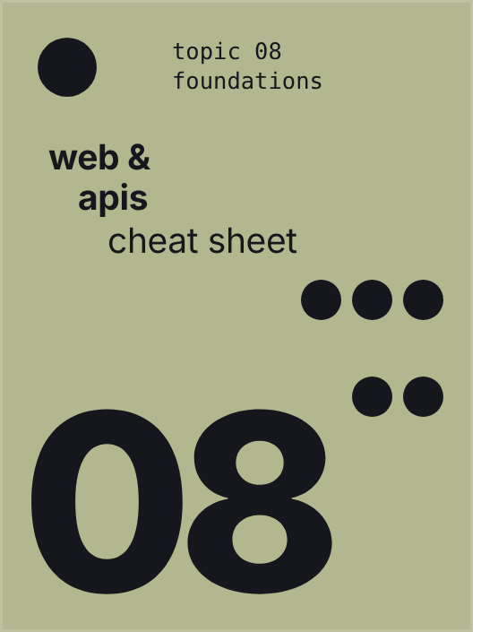
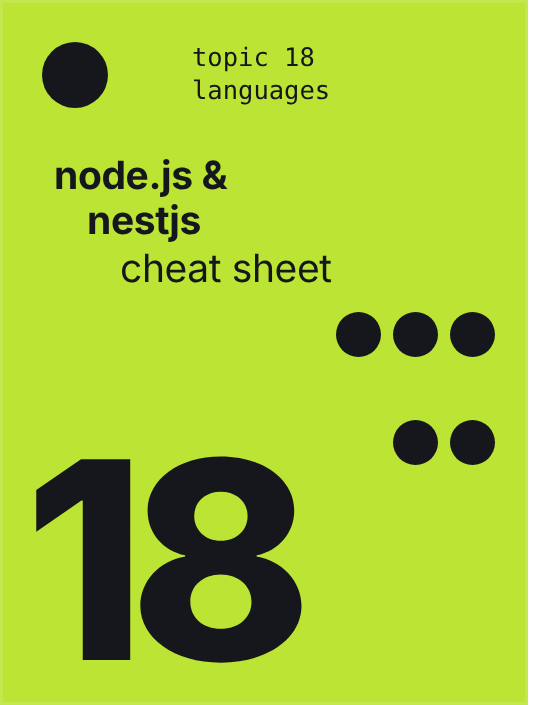
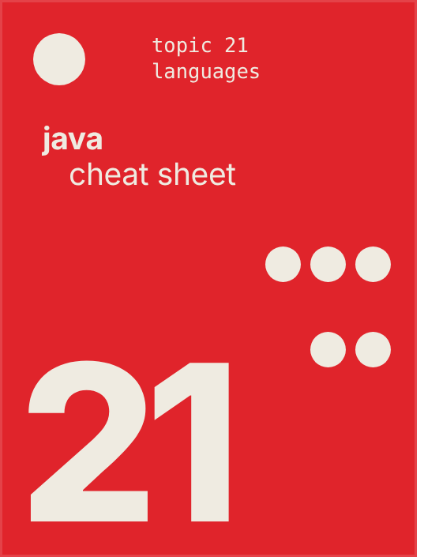
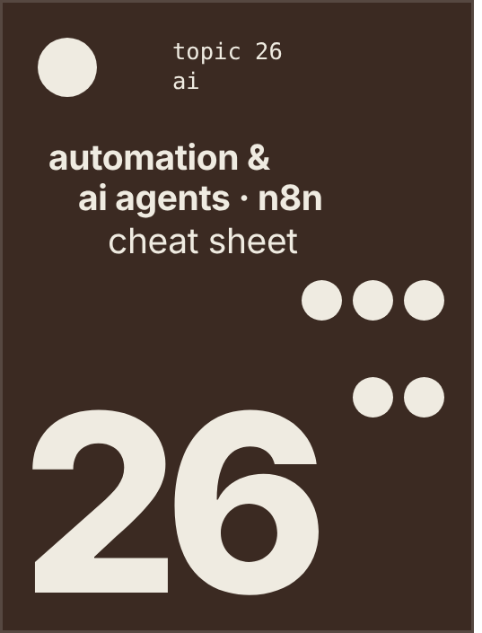

AI engineer and full-stack developer. I build end to end: back ends in Python and FastAPI with LLMs, RAG and agents at their core, and front ends in React, Next.js and TypeScript.

**Developer reference series**: a long-term project built in the open. It grew out of appreciation for the mentors and colleagues whose work shaped my learning, and from a lesson learned in the process: mastering these fields takes hard work and time. It is meant for anyone setting out to learn them, and for colleagues looking for a clear reference when needed.

Each module has its own repository, built on the same structure: the explanation, a cheat sheet, working examples and real projects that apply it, with the reasoning behind each decision. There are 26 modules for now, a starting point rather than a limit. This profile is updated as the books and projects advance.

## Tech Stack:

                                

## Shipped.

### Featured

**[Polaris](https://polaris-fawn-two.vercel.app)** · Python · FastAPI · LangChain · Chroma · Groq 
A RAG assistant over Argentine Central Bank regulations. Its security review found three things worth fixing. A provider error was reaching the browser with my organization ID, plan limits and model name; clients now get a generic message instead, the full detail stays in the logs, and my bugs (500) are kept apart from provider failures (503). Each question travels inside its own tags, and the same markers are stripped from anything a user types, so nobody can fake a retrieved passage. And a 25-second timeout with one retry could take 51 seconds against the front end's 30, which is why it now waits 15 and doesn't retry. Testing also showed references sometimes arriving wrapped in 【】 brackets; normalizing them first kept the citation check from rejecting valid answers.

**[Alphecca](https://alphecca-eight.vercel.app/)** · Python · FastAPI · Pydantic · Next.js · TypeScript 
Describe what you need and it recommends an LLM from Google, OpenAI or Anthropic. The first version was built on Streamlit; today it's Next.js with a FastAPI back end. Next: semantic search over the providers' docs, to answer questions like "which models break if I send temperature?"

**[Ethos](https://ethos-health-bice.vercel.app)** · FastAPI · PostgreSQL · Node.js · React 
A clinic booking app for a fictional functional-medicine practice. The front end went live ahead of the back end: it talks to one interface with two adapters, demo and HTTP, picked by an environment variable, so the switch took a single setting. When it was ready to share, I reviewed its security: registration is off in production, the waitlist validates input without keeping any email, login has a rate limit, and the content security policy runs in report-only mode first, so nothing breaks until it's enforced. Next: capping how far ahead someone can book, memberships with Stripe, and testing the LLM layer that helps clinicians interpret patient metrics.

**[Lynx](https://lynx-site-chi.vercel.app/)** · Python · LangGraph · Gemini · FastAPI 
Detects fraud, scams and financial exploitation of older adults in their bank accounts. Before making it public, I reviewed the repository: nothing left from the original challenge material, and a clean dependency audit. Next, ahead of the evals: setting a timeout on the Gemini SDK.

**[Marvel Characters](https://marvel-characters-coral.vercel.app/)** · Next.js · React · TypeScript · Zod 
An older project of mine, rebuilt as a searchable browser of 304 characters. Its hardening pass pinned the dataset to a fixed commit, so an upstream change can't alter it silently, limited images to HTTPS from two allowed sources, and added protective headers while hiding the framework's signature. Next: a real 404 for characters that don't exist.

**[Blaze](https://github.com/mssegosende/blaze-ai-editor)** · Node.js · Hono · OpenRouter · React · TypeScript · Tiptap 
A Markdown editor with an AI assistant. The assistant is a single-step agent: one action and one call per request, which keeps cost and behavior predictable and leaves every change to the person. The Claude Code sessions I built it with are saved unedited in `ai-sessions/`, so anyone can see how that collaboration went.

### Built, not deployed yet

| Project | What it does | Stack | Status |
|---|---|---|---|
| **Larawag** | A support API that creates exactly one ticket per message, even when the same message arrives 50 times at once | Python, FastAPI, PostgreSQL, n8n, Docker | [Repo](https://github.com/mssegosende/larawag) · not deployed yet |
| **Helvetios** | A core banking system: accounts, balances and every money movement, with double-entry accounting | Python, FastAPI, PostgreSQL | Repo · not deployed yet |
| **Arcturus** | A multi-agent pipeline that reviews pull requests against business rules and hands them to a human when the rating is too low | Python, LangChain, LangGraph, OpenAI | Local repo, not on GitHub yet |
| **Titanium TX** | A marketplace for heavy commercial vehicles: inventory, listings and lead generation | React, Tailwind CSS | Local repo, not on GitHub yet |
| **Apsis** | A personal AI productivity app: week view, study tracking and expenses, with an LLM to ask questions | React, TypeScript, Tailwind CSS, Vite | Local repo, not on GitHub yet |

## From March to now.

<b>November 2026: more projects and the series</b>

- **Shipped:** Polaris, Alphecca and Ethos went from repo to deploy, Marvel Characters came back rebuilt.
- **Alphecca:** I needed a way to compare models for myself. It estimates, from the tokens you use per day, which model suits your workload and which one costs less. I built it to scale.
- **The series:** 5 of 3 books are finished and 2 more on the way.
- **The portfolio:** it's finished. From here, it simply keeps growing, with more projects and more videos as I build them.

<b>October 2026: more challenges, AI engineering and data science</b>

- **Lynx:** I was studying fraud cases and brought AI engineering into one of them. I didn't know it was a data science challenge until I was already doing it. I ended up investigating it about it and defending it. Now I'm testing it against new cases.
- **Polaris:** finished, ready to go live.
- **Portfolio:** finished, with the projects I chose to show.
- **The series:** I mapped 26 books and wrote the first three, Git & GitHub, Docker & Kubernetes and OOP.

<b>September 2026: back to where I started</b>

- **Ethos:** I started it from scratch, with FastAPI, PostgreSQL and SQLAlchemy 2.0 behind an Express gateway. I took charge of every layer, from the database to the deploy.
- **Alphard:** my friend and I kept learning the best business rules of finance as we built it. 
- **Portfolio:** I started building it.

<b>August 2026: first sight of complete projects</b>

- **Going deeper:** besides databases, I studied the back end and the structure behind it in depth. I made things more complex on purpose, so I could focus on the problems that matter most.
- **Alphard, Helvetios and Larawag:** all three were designed and started this month, side by side.
- **n8n finds its place:** in Larawag, it sits at the edge of the system, never at its core.
- **Data at scale:** after studying databases in July, I wanted to see how a very large integration works. I had migrated front ends and services before, but never the data layer. I like understanding the whole picture, so I set out to learn how it's done and how I would approach it.

<b>July 2026: deciding to change</b>

- **From features to full projects:** instead of leaving ideas as ideas, as I always had, or building isolated features, I started creating complete projects, putting them up in my lab and checking how far they could go.
- **Databases and machine learning:** how data moves with agents caught my attention, so I went back to databases and to how machine learning connects with them.
- **Titanium TX:** a marketplace for heavy commercial vehicles. I already knew how to build this kind of app, so I set myself the challenge of digging into its business rules. The front end is built and what it will do is clear, so the deploy comes next.

<b>June 2026: machine learning</b>

- **Machine Learning in Production (DeepLearning.AI):** I learned to see machine learning as a lifecycle, not a single step, and that improving the data often pays off more than tuning the model.
- **Apsis:** a tool for myself with an LLM inside, where I could ask anything. Building it showed me that not every question needs the same model. It also taught me that an app that makes me log everything soon becomes a chore, and looking into that led to the projects I find most useful today.

<b>May 2026: back to the foundations</b>

- **The fundamentals, again:** I reviewed software design, from layers and domain entities to hexagonal architecture.
- **At work:** I designed a code-review pipeline based on RAG, which later became Arcturus.

<b>April 2026: systems and security</b>

- **UTN-FRD:** I began the University Diploma in Linux Network Administration with a focus on Cybersecurity, to understand the parts of a system beyond my own code.
- **In practice:** every project in Shipped went through a security review based on what I learned here.

<b>March 2026: automation</b>

- **n8n:** I researched it through engineers' YouTube channels, which helped me understand it and decide what was worth learning. Then a full course showed me what it could automate, from webhooks to AI agents, and left me with a list of ideas still to build.
- **Next step:** I decided to take it slowly and figure out how to fit it into complete projects of my own, starting with where n8n ends and the business logic begins.

## The series, on the shelf.

The first books are out: Git & GitHub, Docker & Kubernetes, OOP, AI engineering and Python. Each one opens its repo: cheat sheet, runnable examples, exercises and a real project. Coming next: Design patterns, Async & reactive, and Cloud & scalability. The rest of the shelf fills in as I go. Scroll sideways to see all 26.

<pre></pre>

## All 26 at a glance.

---

WORK IN PROGRESS · <a href="https://github.com/mssegosende">@mssegosende</a>

