Software engineer, full-stack and AI: state-driven interfaces (React, TypeScript) and LLM backends (Python, FastAPI).

**Developer reference series**: a long-term project built in the open. It grew out of appreciation for the mentors and colleagues whose work shaped my learning, and from a lesson learned in the process: mastering these fields takes hard work and time. It is meant for anyone setting out to learn them, and for colleagues looking for a clear reference when needed.

Each module has its own repository, built on the same structure: the explanation, a cheat sheet, working examples and real projects that apply it, with the reasoning behind each decision. There are 26 modules for now, a starting point rather than a limit. This profile is updated as the books and projects advance.

## Tech Stack:

  
  
  
  
  
  
  
  
  
  
  
  
  
  
  
  
  
  
  
  
  
  
  
  

## The series, on the shelf.

The first books are out: Git & GitHub, Docker & Kubernetes, OOP, AI engineering and Python. Each one opens its repo: cheat sheet, runnable examples, exercises and a real project. The rest of the shelf fills in as I go. Scroll sideways to see all 26.

<pre><a href="https://github.com/mssegosende/01-git-github">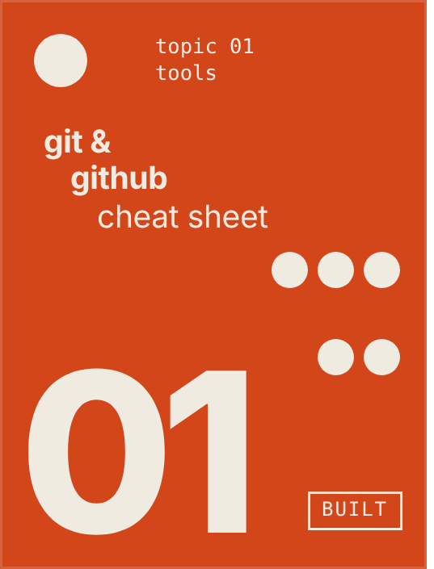</a><a href="https://github.com/mssegosende/02-docker-kubernetes">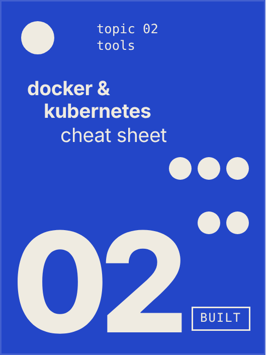</a><a href="https://github.com/mssegosende/04-oop">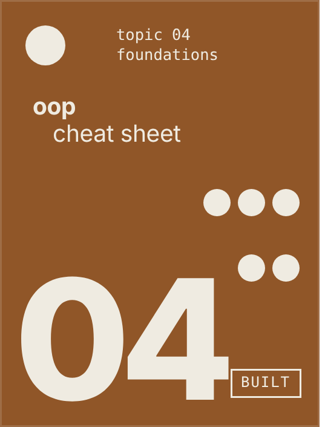</a>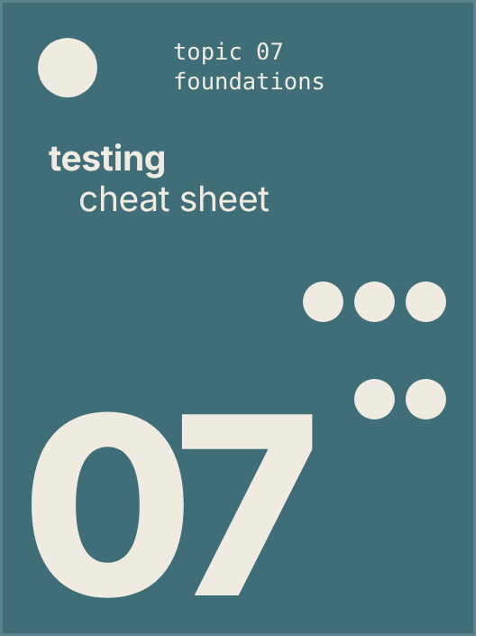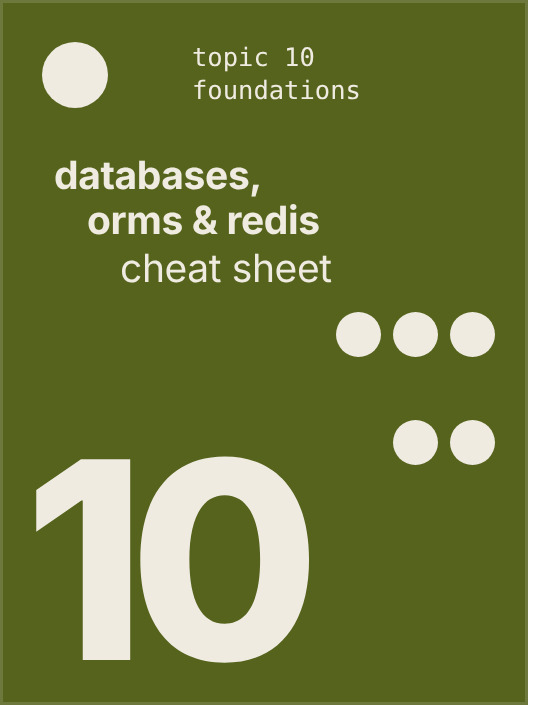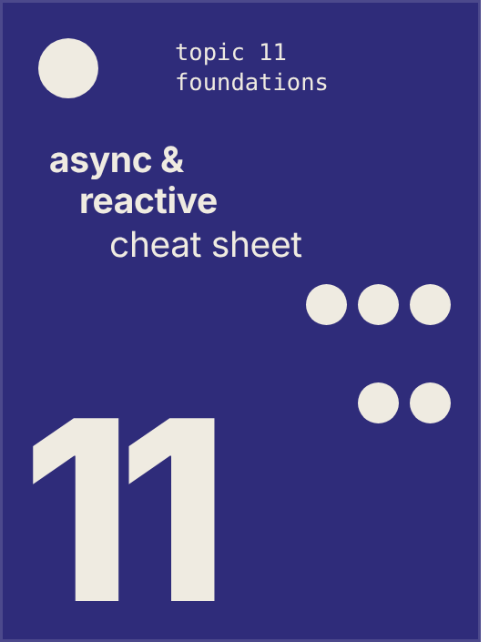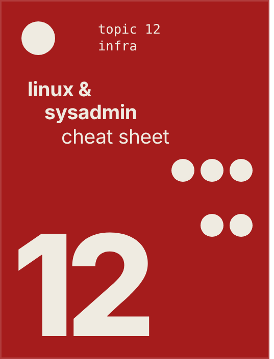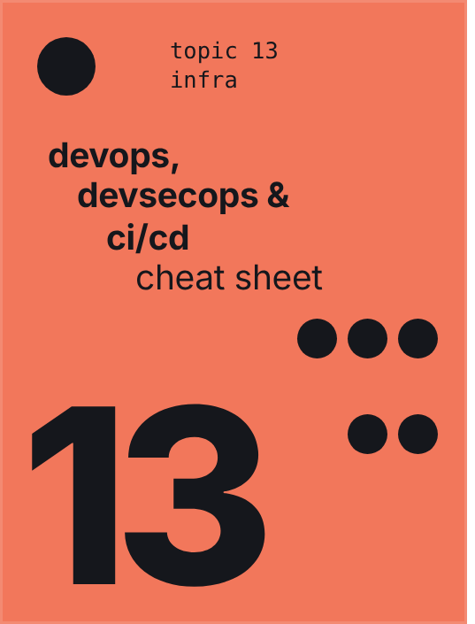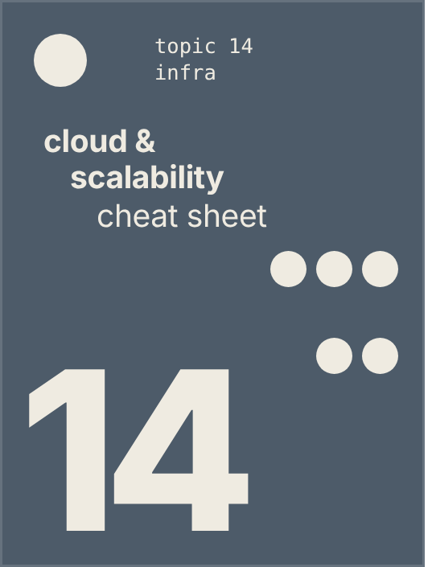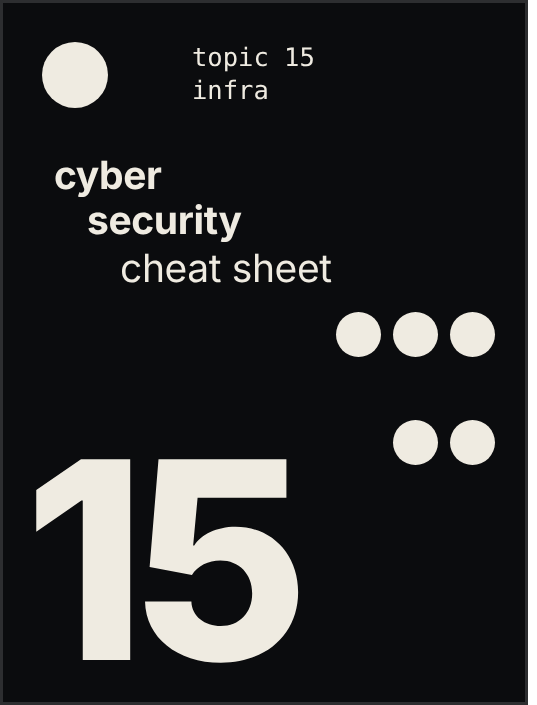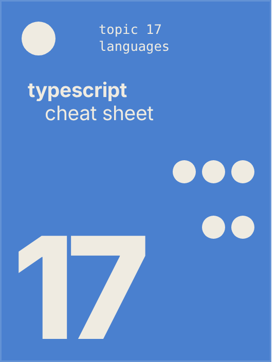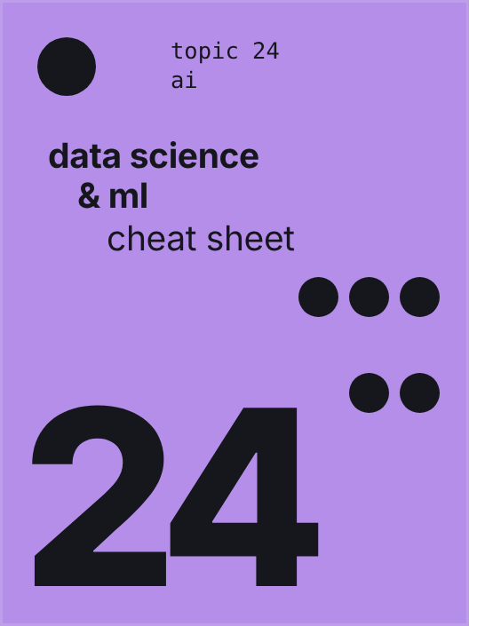</pre>

## On the desk.

- **Studying:** Python, FastAPI and PostgreSQL in depth: data modeling, transactions, concurrency and testing. Alongside it, *Machine Learning in Production* (DeepLearning.AI).
- **Building:** Ethos, a clinic app. Next step: splitting appointments, payments and patient data into their own services.
- **Reviewing:** a security review across all my projects, built from what I learned shipping Polaris.

## All 26 at a glance.

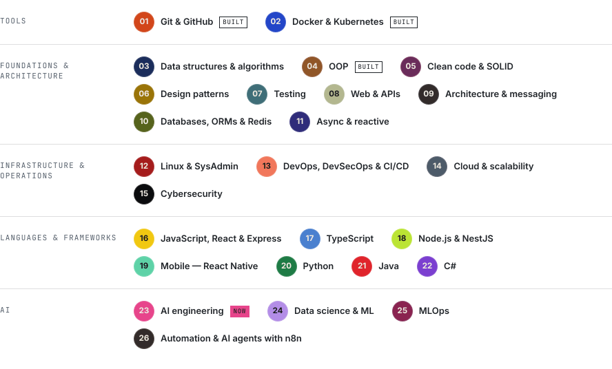

## Latest updates.

- **November 2026:** first books published: Git & GitHub, Docker & Kubernetes, OOP, AI engineering and Python. Profile redesigned, with light and dark themes on web and mobile.
- **October 2026:** cheat sheets written for Git & GitHub, Docker & Kubernetes and OOP.

---

WORK IN PROGRESS · <a href="https://github.com/mssegosende">@mssegosende</a>

