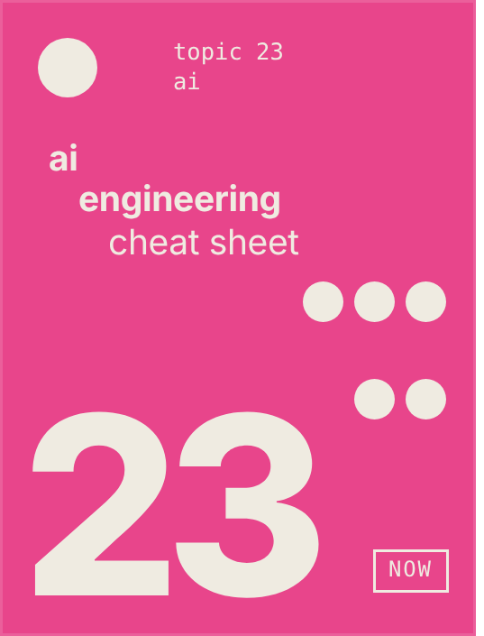
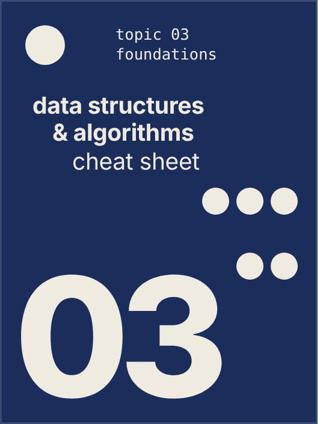
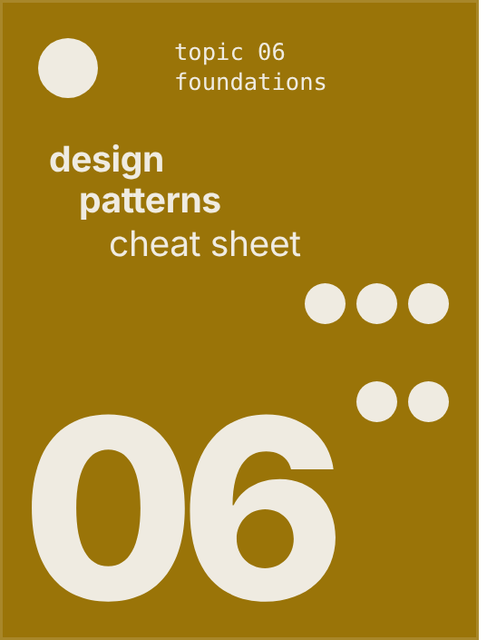
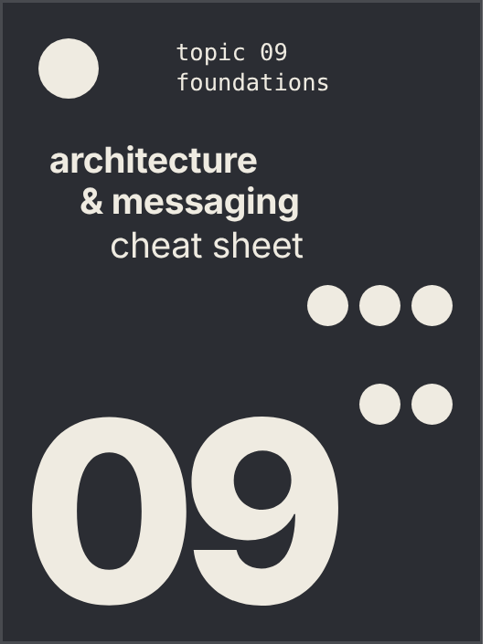
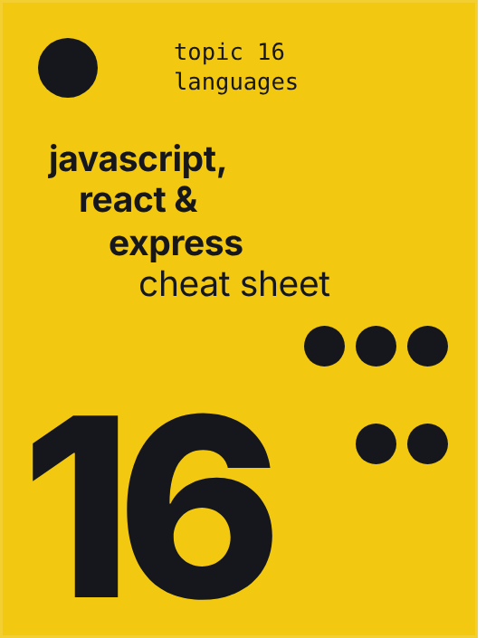
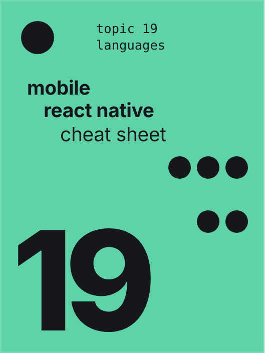
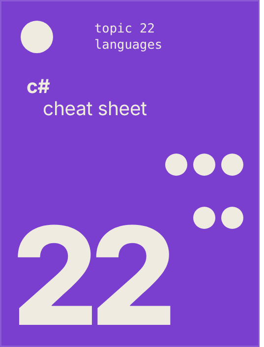
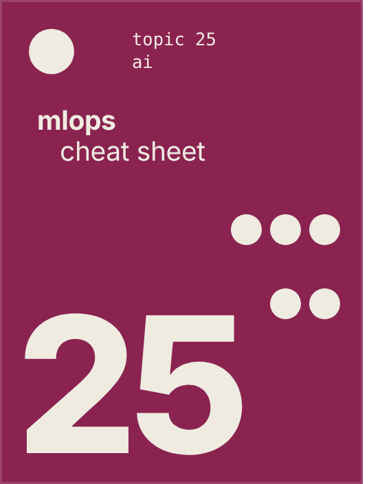

Software engineer, full-stack and AI: state-driven interfaces (React, TypeScript) and LLM backends (Python, FastAPI).

**Developer reference series**: a long-term project built in the open. It grew out of appreciation for the mentors and colleagues whose work shaped my learning, and from a lesson learned in the process: mastering these fields takes hard work and time. It is meant for anyone setting out to learn them, and for colleagues looking for a clear reference when needed.

Each module has its own repository, built on the same structure: the explanation, a cheat sheet, working examples and real projects that apply it, with the reasoning behind each decision. There are 26 modules for now, a starting point rather than a limit. This profile is updated as the books and projects advance.

## Tech Stack:

  
  
  
  
  
  
  
  
  
  
  
  
  
  
  
  
  
  
  
  
  
  
  
  
  
  
  
  
  
  

## Shipped.

| Project | What it does | Stack | Link |
|---|---|---|---|
| **Polaris** | RAG assistant over Argentine Central Bank regulations; every answer cites the clause it came from | Python, FastAPI, LangChain, Chroma, Groq | [Live](https://polaris-fawn-two.vercel.app) |
| **Alphecca** | Picks the right LLM for a workload, with the cost math behind the choice | Python, embeddings | [Live](https://alphecca-eight.vercel.app/) |
| **Ethos** | Clinic app split into services: React front end, Node gateway with JWT auth, FastAPI appointments service | React, Node.js, FastAPI, PostgreSQL | [Live](https://ethos-health-bice.vercel.app) |
| **Blaze** | AI co-writing editor for Markdown, designed and built in about a week | TypeScript, LLM APIs | [Repo](https://github.com/mssegosende/blaze-ai-editor) |
| **Lynx** | Flags fraud and financial abuse of older adults; rules and an LLM read each case, code makes the final call | Python, LangGraph, FastAPI | |
| **Marvel Characters** | 304 characters fetched, filtered and validated at runtime | Next.js, TypeScript, Zod | |
| **Portfolio** | My site, with a FastAPI contact service | React, FastAPI, Resend | [Live](https://msse-portfolio.vercel.app) |

## From July to now.

<b>November 2026: refining what I chose</b>

- **Making the chosen projects better:** Polaris, Alphecca and Ethos went live, and my portfolio got a full redesign.
- **Blaze:** an AI co-writing editor for Markdown, built in about a week as a technical assessment.
- **Lynx:** rebuilt after a technical review.
- **Marvel Characters:** Next.js, TypeScript and Zod.
- **Alphard:** building it with a friend. A real-time fraud detection and risk-scoring engine for banking.
- **AI engineering:** going deeper.

<b>October 2026: AI engineering and the portfolio</b>

- **AI engineering course:** LLMs, prompting, embeddings, RAG, tool use and agents.
- **Arcturus:** a multi-agent pipeline that reviews pull requests and hands them to a human when the rating is too low.
- **Polaris:** a RAG assistant over Argentine Central Bank regulations.
- **Portfolio:** chose the projects that go in it and added a Python contact service.
- **Ethos:** front end finished, back end started.
- **First books of the series:** Git & GitHub, Docker & Kubernetes and OOP, finished by Halloween.

<b>September 2026: architecture</b>

- **Portfolio v1:** React, TypeScript and a design system of my own, deployed on Vercel.
- **Titanium TX:** a mobile-first marketplace mockup for commercial vehicles.
- **Project specs:** one reusable template for every project: business rules, architecture, DevOps and vertical slices.
- **Cybersecurity:** UTN diploma in Linux, cybersecurity and ethical hacking.
- **Mock technical interviews** with a study partner.

<b>July – August 2026: foundations</b>

- **Apsis:** a personal AI productivity app in React, TypeScript and Tailwind.
- **3D character viewer:** Node.js, Express and SQLite, with models prepared in Blender.
- **Agent stack:** RAG, MCP, FastAPI and n8n, rebuilt until I could explain every part.
- **Alphard:** started with a friend.

## The series, on the shelf.

The first books are out: Git & GitHub, Docker & Kubernetes, OOP, AI engineering and Python. Each one opens its repo: cheat sheet, runnable examples, exercises and a real project. The rest of the shelf fills in as I go. Scroll sideways to see all 26.

<pre></pre>

## On the desk.

- **Building:** Alphard, with a friend: a real-time fraud detection and risk-scoring engine for banking, with FastAPI, PostgreSQL and anomaly detection.
- **Refining:** Ethos, splitting appointments, payments and patient data into their own services.
- **Studying:** Python, FastAPI and PostgreSQL in depth, and AI engineering beyond the basics.

## All 26 at a glance.

## Latest updates.

- **November 2026:** refining my portfolio projects. Polaris, Alphecca, Ethos and the portfolio went live; Blaze delivered; AI engineering and Python books published; building Alphard with a friend.
- **October 2026:** first books written: Git & GitHub, Docker & Kubernetes and OOP. Built Polaris, Arcturus and the Ethos front end.

---

WORK IN PROGRESS · <a href="https://github.com/mssegosende">@mssegosende</a>

Software engineer, full-stack and AI: state-driven interfaces (React, TypeScript) and LLM backends (Python, FastAPI).

**Developer reference series**: a long-term project built in the open. It grew out of appreciation for the mentors and colleagues whose work shaped my learning, and from a lesson learned in the process: mastering these fields takes hard work and time. It is meant for anyone setting out to learn them, and for colleagues looking for a clear reference when needed.

Each module has its own repository, built on the same structure: the explanation, a cheat sheet, working examples and real projects that apply it, with the reasoning behind each decision. There are 26 modules for now, a starting point rather than a limit. This profile is updated as the books and projects advance.

## Tech Stack:

  
  
  
  
  
  
  
  
  
  
  
  
  
  
  
  
  
  
  
  
  
  
  
  
  
  
  
  
  
  

## Shipped.

| Project | What it does | Stack | Link |
|---|---|---|---|
| **Polaris** | RAG assistant over Argentine Central Bank regulations; every answer cites the clause it came from | Python, FastAPI, LangChain, Chroma, Groq | [Live](https://polaris-fawn-two.vercel.app) |
| **Alphecca** | Picks the right LLM for a workload, with the cost math behind the choice | Python, embeddings | [Live](https://alphecca-eight.vercel.app/) |
| **Ethos** | Clinic app split into services: React front end, Node gateway with JWT auth, FastAPI appointments service | React, Node.js, FastAPI, PostgreSQL | [Live](https://ethos-health-bice.vercel.app) |
| **Blaze** | AI co-writing editor for Markdown, designed and built in about a week | TypeScript, LLM APIs | [Repo](https://github.com/mssegosende/blaze-ai-editor) |
| **Lynx** | Flags fraud and financial abuse of older adults; rules and an LLM read each case, code makes the final call | Python, LangGraph, FastAPI | |
| **Marvel Characters** | 304 characters fetched, filtered and validated at runtime | Next.js, TypeScript, Zod | |
| **Portfolio** | My site, with a FastAPI contact service | React, FastAPI, Resend | [Live](https://msse-portfolio.vercel.app) |

## From July to now.

<b>November 2026: refining what I chose</b>

- **Making the chosen projects better:** Polaris, Alphecca and Ethos went live, and my portfolio got a full redesign.
- **Blaze:** an AI co-writing editor for Markdown, built in about a week as a technical assessment.
- **Lynx:** rebuilt after a technical review.
- **Marvel Characters:** Next.js, TypeScript and Zod.
- **Alphard:** building it with a friend. A real-time fraud detection and risk-scoring engine for banking.
- **AI engineering:** going deeper.

<b>October 2026: AI engineering and the portfolio</b>

- **AI engineering course:** LLMs, prompting, embeddings, RAG, tool use and agents.
- **Arcturus:** a multi-agent pipeline that reviews pull requests and hands them to a human when the rating is too low.
- **Polaris:** a RAG assistant over Argentine Central Bank regulations.
- **Portfolio:** chose the projects that go in it and added a Python contact service.
- **Ethos:** front end finished, back end started.
- **First books of the series:** Git & GitHub, Docker & Kubernetes and OOP, finished by Halloween.

<b>September 2026: architecture</b>

- **Portfolio v1:** React, TypeScript and a design system of my own, deployed on Vercel.
- **Titanium TX:** a mobile-first marketplace mockup for commercial vehicles.
- **Project specs:** one reusable template for every project: business rules, architecture, DevOps and vertical slices.
- **Cybersecurity:** UTN diploma in Linux, cybersecurity and ethical hacking.
- **Mock technical interviews** with a study partner.

<b>July – August 2026: foundations</b>

- **Apsis:** a personal AI productivity app in React, TypeScript and Tailwind.
- **3D character viewer:** Node.js, Express and SQLite, with models prepared in Blender.
- **Agent stack:** RAG, MCP, FastAPI and n8n, rebuilt until I could explain every part.
- **Alphard:** started with a friend.

## The series, on the shelf.

The first books are out: Git & GitHub, Docker & Kubernetes, OOP, AI engineering and Python. Each one opens its repo: cheat sheet, runnable examples, exercises and a real project. The rest of the shelf fills in as I go. Scroll sideways to see all 26.

<pre></pre>

## On the desk.

- **Building:** Alphard, with a friend: a real-time fraud detection and risk-scoring engine for banking, with FastAPI, PostgreSQL and anomaly detection.
- **Refining:** Ethos, splitting appointments, payments and patient data into their own services.
- **Studying:** Python, FastAPI and PostgreSQL in depth, and AI engineering beyond the basics.

## All 26 at a glance.

## Latest updates.

- **November 2026:** refining my portfolio projects. Polaris, Alphecca, Ethos and the portfolio went live; Blaze delivered; AI engineering and Python books published; building Alphard with a friend.
- **October 2026:** first books written: Git & GitHub, Docker & Kubernetes and OOP. Built Polaris, Arcturus and the Ethos front end.

---

WORK IN PROGRESS · <a href="https://github.com/mssegosende">@mssegosende</a>

